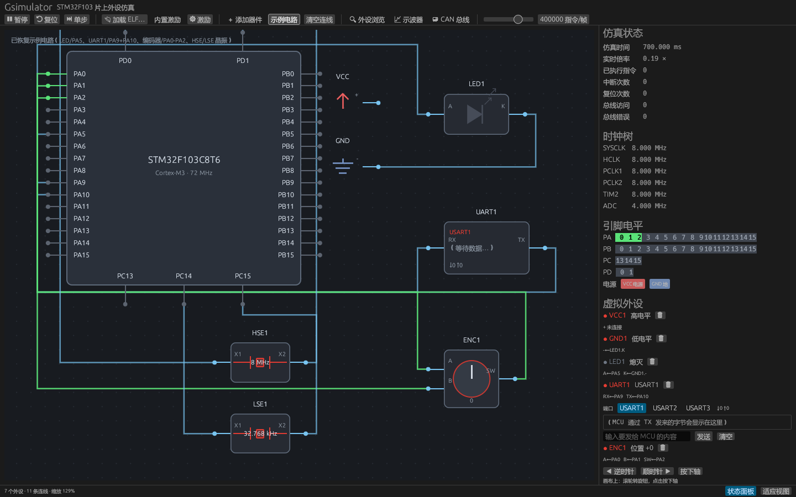
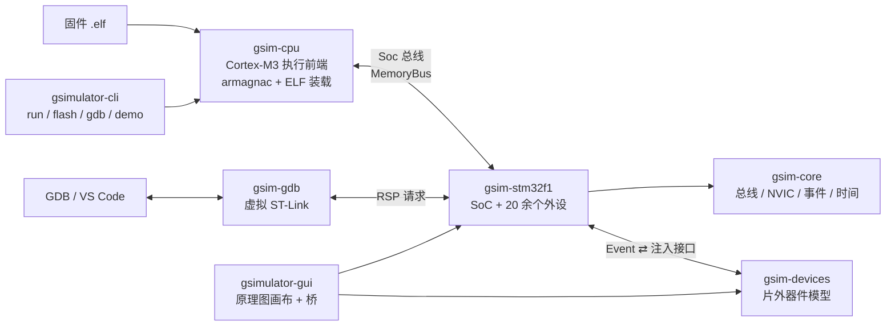

<div align="center">

# Gsimulator

**STM32F103 全外设模拟器 —— 真跑固件 · 原理图接线 · GDB 调试**

在 PC 上执行真实的 Cortex-M3 固件，像嘉立创 EDA 那样把 LED、点阵、编码器、CAN 收发器接到芯片引脚上，
再用 GDB / VS Code 像接真板子一样下断点、单步、看寄存器。


[快速开始](#quickstart) · [图形前端](#gui) · [命令行](#cli) · [调试](#debug) · [架构](#arch) · [外设](#peripherals) · [测试](#tests)

</div>



> 打开 [`docs/example.gsim`](docs/example.gsim) 的样子：中间是按 **LQFP48 真实引脚排列**画的 STM32F103C8T6，
> 右边是 LED、UART 终端和旋转编码器，连线颜色就是网络电平（绿=高、蓝=低、红=短路、暗=悬空）。

---

## ✨ 为什么值得一试

| 能力 | 说明 |
| --- | --- |
| **真实固件** | 任意 `arm-none-eabi-gcc` / Keil 产出的 Cortex-M3 ELF 直接装载执行（Thumb-2 解释器 [armagnac](https://crates.io/crates/armagnac)），CubeMX + HAL 工程开箱即跑 |
| **寄存器级外设** | 按 RM0008 建模 20+ 模块：RCC / GPIO / AFIO / EXTI / USART / SPI / I2C / bxCAN / TIM / ADC / DMA / FLASH / PWR / BKP / RTC / IWDG / WWDG / CRC / DBGMCU，含**位带别名**与 DMA 请求路由 |
| **EDA 式接线台** | 器件库（分类 + 搜索 + 拖放）、正交折线自动布线并绕开器件、自定义拐点、双击插接线节点、`.gsim` 文本工程文件 |
| **片外器件** | UART 终端、旋转编码器、MAX7219 8×8 点阵、CAN 收发器、CAN 电机、电阻、示波器、HSE/LSE 晶振 —— 都在 `gsim-devices`，**没接线就没有数据** |
| **位级 CAN** | 位填充、CRC-15、线与仲裁、ACK 槽、错误帧、TEC/REC/bus-off；终端电阻并联值 → 线路质量 → 振铃翻位，示波器能逐位看字段 |
| **虚拟 ST-Link** | 自己实现的 GDB 远程协议服务器：`load` / 断点 / 监视点 / 单步 / Ctrl-C / `monitor`；GUI 内建一份，**断点停的就是画布上那份仿真** |
| **可复现** | 时间只由仿真推进（纳秒 + `NanoAccumulator`），不读真实时钟、不 `sleep`；测试能逐字节断言 UART 输出 |

---

<a id="quickstart"></a>

## 🚀 快速开始

```powershell
# 1. 编译 + 全量测试（约 430 条；缺交叉编译器/GPU/真实 gdb 时相关用例自动跳过）
cargo build
cargo test --workspace

# 2. 不写任何固件，先看它能干什么
cargo run -p gsimulator-cli -- demo     # 脚本化巡览全部外设并打印时序
cargo run -p gsimulator-cli -- info     # 打印模拟的内存映射

# 3. 打开图形前端
cargo run -p gsimulator-gui
```

| 依赖 | 什么时候需要 |
| --- | --- |
| Rust **1.85+** | 总是（GUI 用到 egui 0.32） |
| `arm-none-eabi-gcc` | 执行/编译真实固件；缺失时相关测试跳过 |
| `arm-none-eabi-gdb` | 命令行调试与真实 GDB 测试；缺失时跳过 |
| CJK 字体 | GUI 中文标签；程序会自动查找系统字体，也可 `GSIM_FONT=xxx.ttf` 指定 |

---

<a id="gui"></a>

## 🖥️ 图形前端（虚拟接线台）

```powershell
cargo run -p gsimulator-gui                     # 新工程：自动摆好 HSE 晶振，其余从器件库放
cargo run -p gsimulator-gui -- path\to\app.elf  # 直接用真实固件的引脚输出驱动外设
```

界面用 [egui/eframe](https://github.com/emilk/egui)（纯 Rust 立即模式 GUI）写成，一屏就能干完这些事：

| 区域 | 你能做什么 |
| --- | --- |
| **画布** | STM32F103C8T6 按 LQFP48 真实引脚排列绘制（1–12 左、13–24 底、25–36 右、37–48 顶），37 个信号脚可连线并带实时电平指示；中键平移、滚轮缩放 |
| **器件库**（＋ 添加器件） | 按「电源 / 时钟 / 指示 / 通信 / 交互 / 显示」分类，带符号预览、引脚名、搜索框；点「放置」再点画布，或直接把卡片拖进去 |
| **接线** | 点一个引脚 → 点另一个引脚即可（也可按住拖）；连线自动走正交折线、**绕开所有器件外形**（先试直角/Z 形，拥挤时才走 A\*）；颜色跟随网络电平 |
| **拐点与节点** | 选中连线拖线段即生成拐点（2 单位吸附，`Delete` 删）；**双击连线**插入接线节点，节点本身是端子，可以从地线中间再引一根出去 |
| **状态面板** | 仿真时间、实时倍率、指令数、中断/复位次数、总线访问、完整时钟树、逐引脚电平矩阵、虚拟外设列表、USART1 输出窗口 |
| **调试服务**（🐞） | 指定端口（默认 3333）+ 开关内建虚拟 ST-Link，让 GDB / VS Code 直接调试这份正在跑的仿真 |
| **工程文件** | 💾 / 📂（`Ctrl+S` / `Ctrl+O`）把整张原理图存成可读的 `.gsim`，能看 diff、能手改 |

窗口一览：`🔍 外设浏览`（所有片上外设 + 画布上的片外器件）、`📈 示波器`（CANH/CANL 波形 + 逐位字段标尺）、
`🚌 CAN 总线`（电气状态、控制器寄存器、帧记录、注入帧）、`⚙ 激励`（内置波形配置）、`🐞 调试服务`。

### 可放置的虚拟外设

<details>
<summary><b>点开看全部器件：引脚 / 行为 / 操作</b></summary>

| 外设 | 引脚 | 行为 | 操作 |
| --- | --- | --- | --- |
| **LED** | `A`（阳） `K`（阴） | 纯消费端，按网络电平点亮；亮度按一段时间内的高电平占比算（定时器 PWM 也能调光） | — |
| **UART 终端** | `RX` `TX` `VCC` `GND` | 把 MCU 在所选 USART 上**真实移位输出**的字节显示成文本，并把输入的文本送进该 USART 的接收器 | 面板选 USART1/2/3、输入后回车或点「发送」 |
| **旋转编码器** | `A` `B` `SW` `VCC` `GND` | 正交编码器，一个定位点 = 4 个四分之一相位（格雷码），每 2 ms 释放一个边沿；轴按下时把 `SW` 拉低 | 画布上**滚轮**转、**点击**按轴；也可用面板按钮 |
| **VCC / GND** | `+` / `-` | 电源符号：接到的整个网络被拉高 / 拉低（两者接到同一网络即短路告警） | 可放多个，拖动、`Delete` 删除 |
| **CAN 收发器** | `TXD` `RXD` `CANH` `CANL` `VCC` `GND` | 物理层：`TXD` 的电平按位驱动总线对，`RXD` 回送线与采样结果；`CANH`/`CANL` 是真正的两条线 | 画布显示模式与帧数；「CAN 总线」窗口可看帧、注入帧 |
| **电阻** | `1` `2` | 无源器件；跨接在 `CANH`/`CANL` 上就是**终端电阻**，并联值决定总线质量 | 面板改阻值（30/60/120/240/1 kΩ 或任意值） |
| **示波器** | `H` `L` | 两通道探头，每个仿真位采样一次，画出两条线的电压与差分；振铃导致的翻转用红色竖线标出 | 「📈 示波器」窗口：时基、档位、冻结、位标尺与逐位定义 |
| **CAN 电机** | `CANH` `CANL` `VCC` `GND` | 总线上的独立节点：只听标准数据帧 `0x200`，`data[0..2]` 是大端有符号 16 位目标转速；轴以 6000 rpm/s 逼近并按仿真时间积分圈数 | 面板改指令 ID、点「正转 / 反转 / 停止」（真的走仲裁发一帧）；画布上画转速与圈数 |
| **SPI 灯阵** | `DIN` `CLK` `CS` `DOUT` `VCC` `GND` | MAX7219 驱动的 8×8 点阵：按 SPI 时钟移位、`CS` 上升沿锁存 16 位字，`DOUT` 回送 16 位前的字节 | 画布直接显示点阵画面；「外设浏览」有寄存器细节与放大预览 |
| **HSE 晶振** | `X1` `X2` | 8 MHz 高速晶体（PD0/PD1）。只有接好晶体且固件置位 `HSEON`，`HSERDY` 才会在起振时间后置位 | **新建工程已摆好并接好线**；起振时引脚与连线按晶振频率真实翻转 |
| **LSE 晶振** | `X1` `X2` | 32.768 kHz 手表晶振（PC14/PC15），给 RTC 当时钟源；同样要固件置位 `LSEON` 才起振 | 接到 PC14/PC15（无极性） |
| **接线节点** | `T` | 导线上的分支点，双击连线插入后把该线切成两段（网络不变），可当端子继续引线 | 点节点继续连线；双击删除并让两段并回一根 |

</details>

### 接线规则（EDA 风格）

<details>
<summary><b>点开看供电、引脚匹配与网络规则</b></summary>

* **供电（必须）**：终端、编码器、CAN 收发器、灯阵都有 `VCC` / `GND` 引脚（都在顶边）。
  **没接电或接反的器件不工作**——终端不收不发、编码器不驱动引脚、收发器不上总线、灯阵不吃 SPI 帧；
  状态面板会显示「VCC/GND 已接 / 未接（不工作）/ 接错（不工作）」。供电每个仿真时间片重新判定，
  所以运行中补上电源会立刻恢复工作。
* **UART**：终端的 `RX` 必须真的接在该 USART 的 `TX`（USART1=PA9、USART2=PA2、USART3=PB10）上才收得到字节；
  `TX` 接在 `RX`（PA10/PA3/PB11）上时输入才会进 MCU。没接通就排队，面板显示「N 字节待发送（等待连线）」。
* **编码器**：`A`/`B`/`SW` 各自驱动所连引脚（走 `Soc::gpio_set_input`），所以 EXTI 边沿与 `IDR` 轮询都能看到。
* **CAN**：`TXD`→`CAN1_TX`（PA12）、`RXD`→`CAN1_RX`（PA11）之后控制器才真正接上总线；
  `CANH`/`CANL` 各成一条网络，收发器、终端电阻、探头按网络连通性识别。
* **SPI 灯阵**：`CLK` 与 `DIN` 必须落在同一个 SPI 口的 `SCK`/`MOSI`（SPI1=PA5/PA7、SPI2=PB13/PB15、
  SPI3=PC10/PC12）上才会收到字节；`CS` 接任意 GPIO 作 `LOAD`；`DOUT` 接该口的 `MISO` 才能读回回声。
* **晶振**：`X1`/`X2` 必须真的跨接在对应振荡脚（HSE = PD0/PD1，LSE = PC14/PC15）上才算装了晶体，
  只接一根不算；拔掉后 RCC 会立刻看到振荡器消失（`HSERDY`/`LSERDY` 掉下来）。
* 网络由同一条连线闭包合并成一个网络，网络电平 ∈「高 / 低 / 悬空 / 短路」；
  LED 亮 = 阳极网络为高 **且** 阴极网络为低。

</details>

### 内置激励与电气规则

工具栏的「内置激励」默认**关闭**，点开就按配置驱动某个引脚（走真实寄存器路径 `GPIOx->BSRR`，不是伪造电平），
默认 PA5、120 ms 半周期方波；「⚙ 激励」里可以改：

* **引脚**：PA0–PA15 / PB0–PB15 / PC13–PC15；
* **波形**：方波（半周期 1 µs–5 s、占空比 1 %–99 %）、恒定高/低、**自定义函数**；
* **自定义函数**：变量 `t`/`ms`/`us`，常量 `pi`/`tau`/`e`，函数 `sin/cos/tan/sqrt/abs/floor/ceil/round/fract/min/max/pow/clamp/step`，
  支持 `+ - * / % ^`、比较与 `&& || !`，结果 > 0.5 即高电平（例如 `sin(2*pi*2*t) > 0`、`t >= 0.1 && t < 0.3`）。

仿真时钟**不依赖激励**：关掉后只是没有引脚被驱动，`运行/暂停` 照常推进时钟，外设、虚拟外设与 CAN 总线都继续工作。

### 工程文件（`.gsim`）

逐行 UTF-8 文本，第一行固定 `gsimulator project 1`，之后每个器件一行、每根连线一行：

```text
gsimulator project 1
device 1 vcc 430.00 110.00
device 2 led 600.00 120.00
device 3 resistor 700.00 300.00 ohms=120
device 4 scope 760.00 420.00 window=20000 frozen=0
wire mcu:0:5 dev:2:0
wire dev:1:0 dev:2:1
wire dev:3:0 dev:4:0 680.00,360.00 720.00,360.00
```

* `device <编号> <类型> <x> <y> [选项…]`：类型是 `led`/`uart`/`encoder`/`vcc`/`gnd`/`can`/`matrix`/
  `hse`/`lse`/`resistor`/`scope`/`motor`/`junction`；选项有 `ohms=`、`unit=`、`mode=normal|silent|standby`、
  `window=`/`frozen=`、`cmd=`。
* `wire <引脚> <引脚> [拐点…]`：引脚写成 `mcu:<端口>:<引脚>` 或 `dev:<编号>:<引脚>`，拐点是板坐标的 `x,y`。
* `#` 开头是注释；解析失败会指出行号并保留当前图纸。

仓库自带三份示例：[`docs/example.gsim`](docs/example.gsim)（LED/UART/编码器/晶振）、
[`docs/selftest.gsim`](docs/selftest.gsim)（`firmware/CAN` 自检固件的整套接线）、
[`docs/canspi-heart.gsim`](docs/canspi-heart.gsim)（`firmware/CANSPI` 点亮点阵爱心）。

**时钟源由固件 ELF 决定**：仿真只负责板上有哪些晶振，固件自己的 RCC 配置决定用 HSI/HSE/PLL/LSE/LSI。
两颗晶体都接着也不会互相抢占，只有被 `HSEON`/`LSEON` 打开的那颗才起振。

---

<a id="cli"></a>

## 💻 命令行

```powershell
cargo run -p gsimulator-cli -- demo                # 脚本化巡览全部外设，不需要 ELF
cargo run -p gsimulator-cli -- info                # 打印模拟的内存映射
cargo run -p gsimulator-cli -- run firmware.elf    # 加载并执行真实 Cortex-M3 ELF
cargo run -p gsimulator-cli -- flash firmware.elf  # 烧进模拟 flash（擦除 + 编程 + 回读校验）
cargo run -p gsimulator-cli -- gdb                 # 虚拟 ST-Link：给 GDB 烧录 + 调试
```

`run` 的选项：

| 选项 | 说明 |
| --- | --- |
| `-n, --max-instructions <N>` | 指令预算（默认 5,000,000） |
| `-t, --max-microseconds <N>` | 按仿真时间停止 |
| `--hse <HZ>` | OSC_IN 晶振频率（默认 8 MHz） |
| `--trace` | 在 stderr 上打印外设事件（IRQ、引脚、SPI 帧、日志） |
| `--registers` | 结束时打印 r0–r3/r12/sp/lr/pc |

固件的 USART1 输出走 stdout，其余诊断信息走 stderr，方便管道处理。

`flash` 等价于 `openocd ... -c "program app.elf verify"`：逐页擦除 → 半字编程 → 回读校验，最后打印向量表：

```powershell
cargo run -p gsimulator-cli -- flash firmware/CAN/build/Debug/CAN.elf
# flashed ... (12040 bytes in 13 pages, read back and verified)
# vector table: sp=0x20005000 reset=0x08002B40 (Reset_Handler)
```

### 示例固件

仓库里有两份可以直接跑的固件：

| 工程 | 内容 |
| --- | --- |
| [`firmware/CAN`](firmware/CAN) | **外设自检固件**：不经过 HAL，直接用寄存器把每个已建模外设跑一遍，在 USART1 上逐行打印 `OK`，最后 `ONCHIP 23/23`；之后进入主循环服务原理图上的终端、灯阵、编码器、LED、CAN |
| [`firmware/CANSPI`](firmware/CANSPI) | CubeMX + HAL 工程：SPI1（PA5/PA7/PA4）驱动 MAX7219，上电画一颗爱心并做亮度「心跳」 |

```powershell
cd firmware\CAN
cmake --preset Debug
cmake --build --preset Debug        # -> build/Debug/CAN.elf

cargo run --release -- run firmware\CAN\build\Debug\CAN.elf -t 3000000 --trace
cargo run -p gsimulator-gui         # 📂 打开工程… docs/selftest.gsim，再 加载 ELF… CAN.elf
```

自检固件的报告长这样（每行都是一次真实的寄存器往返）：

```text
GSIM-SELFTEST 1
CLK 72000000 HSE
SYSTICK OK
GPIO OK
BITBAND OK
EXTI OK
USART1 OK
USART2 OK
USART3 OK
SPI1 OK
I2C1 OK
TIM1 OK
TIM2 OK
TIM3 OK
TIM4 OK
ADC OK 2047
DMA OK
FLASH OK
CRC OK 0xC704DD7B
RTC OK
PWR OK
BKP OK
CAN OK
IWDG OK
WWDG OK
ENV HSE=READY LSE=WAIT RTC=LSI RESET=POR
ONCHIP 23/23
DEV MATRIX=NA ECHO=0x00000000
LOOP
EVT READY
```

> `--release` 建议用于长时间运行；debug 构建每秒仿真时间约需数十秒真实时间。

---

<a id="debug"></a>

## 🔌 调试（虚拟 ST-Link）

`gsim-gdb` 是一个**自己实现的 GDB 远程协议服务器**：端口、`target extended-remote`、
`load` 语义都与 OpenOCD 一致，GDB / VS Code 侧不用改任何东西。

### 方式 A：调试 GUI 里正在跑的那份仿真（推荐）

1. `cargo run -p gsimulator-gui`
2. 「📂 加载 ELF…」选固件（例如 `firmware/CANSPI/build/Debug/CANSPI.elf`），「▶ 运行」
3. 工具栏「🐞 调试服务」→ 勾选**开启调试服务**，端口 `3333`
4. VS Code F5 → 选 **「Gsimulator GUI：附加到图形前端」**

服务器跑在 UI 线程上、每帧服务一次 socket，所以**断点命中的就是画布上这份仿真**：
画面立刻停住，单步时能看着点阵一行行走。附加后固件通常已经跑过 `main`，
配置里已内置 `monitor reset halt` 复位再停在 `main`。
仓库根目录与 `firmware/CANSPI` 的 [`.vscode/launch.json`](.vscode/launch.json) 都带这条配置
（`servertype: "external"` + `gdbTarget: "127.0.0.1:3333"`，另有一条自动起 CLI 服务器的配置）。

### 方式 B：命令行起一个独立仿真

```powershell
# 终端 1：起调试服务器（占用 3333，和 openocd 一样）
cargo run -p gsimulator-cli -- gdb

# 终端 2：像调试真实板子一样烧录并调试
arm-none-eabi-gdb firmware/CAN/build/Debug/CAN.elf `
    -ex "target extended-remote 127.0.0.1:3333" `
    -ex "load" -ex "break main" -ex "run"
```

`gdb` 子命令选项：`-p/--port`（默认 3333）、`--bind ADDR:PORT`、`<elf>` / `--elf PATH`（连接前预装镜像）、
`--hse HZ`、`--no-uart`、`-v/--verbose`（逐条打印 RSP 收发）。

| GDB 操作 | 实现 |
| --- | --- |
| `load` | `vFlashErase`/`vFlashWrite` 擦写模拟 flash（1 KiB 页），每次写完回读校验 |
| `break` / `hbreak` | `Z0`/`Z1`，核心在每条指令前比较 PC，不改写指令流，flash 里也能下断点 |
| `watch` / `rwatch` / `awatch` | `Z2`/`Z3`/`Z4`，运行中逐条指令比较被监视的内存（GUI 内建服务暂不支持） |
| `step` / `stepi` / `next` | `vCont;s`，精确执行一条指令 |
| `continue` + Ctrl-C | `vCont;c`；每 10 万条指令轮询一次 socket，收到 `0x03` 立即停下并回 `T02` |
| `info registers` / `print` / `x/…` | `g`/`p`/`m` 包，外设寄存器也能直接读，读未映射地址回报错误而不是崩溃 |
| `monitor reset` / `regs` / `info` / `peripherals` / `flash` / `halt` | 复位、寄存器、指令与时间计数、外设时钟与状态、flash 几何 |

<details>
<summary><b>为什么不是 OpenOCD？</b></summary>

`interface/stlink.cfg` 走的是真实 USB 硬件；常见发行版（包括 EIDE 自带的那份）没有编译
`remote_bitbang` 一类的网络适配器，OpenOCD 没有可以指向模拟器的后端（`openocd -c "adapter list"`
里那 19 个适配器全是 USB 探针）。所以本仓库把 GDB 服务器这一半自己做掉了：端口、连接方式、
`load` 语义都与 OpenOCD 一致，GDB/IDE 侧不用改；只想「烧一下」而不调试时用 `gsimulator flash`。

两个细节：`load` 之后核心的 SP/PC 仍是加载前的值（真实芯片也一样），所以要么 `monitor reset`，
要么直接 `run`（`vRun` 会先复位再从向量表跑）；`monitor reset` 之后若想立刻看寄存器，先 `stepi` 一次。

</details>

---

<a id="arch"></a>

## 🏗️ 架构



| crate | 作用 |
| --- | --- |
| `gsim-core` | 与芯片无关的基础设施：`AccessWidth`/`BusError`、`Ctx`（时钟快照 + `Event` 收集）、`Peripheral`、`Irq`、`Nvic`/`Scb`/`SysTick`、纳秒↔周期 |
| `gsim-stm32f1` | STM32F103 片上外设模型。`Soc` 拥有全部外设，实现 `MemoryBus`，负责步进、EXTI 采样、DMA 引擎与事件汇聚 |
| `gsim-devices` | 片外器件模型（只依赖 `gsim-core`）：UART 终端、编码器、MAX7219、CAN 收发器/位级总线、CAN 电机、电阻、示波器、晶振 |
| `gsim-cpu` | Cortex-M3 执行前端 + ELF 装载 + SoC 桥接 |
| `gsim-gdb` | 虚拟 ST-Link：RSP 编解码、探针视角的设备操作、GDB 服务器 |
| `gsimulator-cli` | 命令行 `run` / `gdb` / `flash` / `demo` / `info` |
| `gsimulator-gui` | 桌面图形前端：原理图画布、接线总线（bridge）、虚拟外设、各种状态窗口 |

### 数据流

```text
                  ┌─────────────── gsim-cpu ───────────────┐
  ELF 文件 ──▶ ElfImage ──▶ load_into(Soc)
                  │                                       │
             armagnac 内核  ◀── SocInterface ── Soc 总线 ──▶ gsim-stm32f1 外设
             (Thumb-2)            (MemoryInterface)              │
                  ▲                                            │
                  └────────── NVIC 仲裁 ────────────────────────┘
```

* 外设不直接碰 NVIC：状态变化以 `Event` 上报，由 `Soc` 统一落到 NVIC / 观察者（片外器件就是这么订阅的）。
* 片外器件只看得到**引脚事件**与**总线帧**，要回灌就走 `gpio_set_input` / `spi_set_miso` / `usart_receive` /
  `can_receive` 这些注入接口——两边没有共享内部字段。

### 时间模型

* 全局时间是**纳秒**；每个外设用 `NanoAccumulator` 把纳秒换算成自己的时钟周期，余数保留，无漂移。
* CPU 侧：1 条指令 = 1 个 HCLK 周期，每执行一批（默认 32 条）后按实际周期推进 `Soc`。
* 无 CPU 时（寄存器级测试）默认步进粒度 1 µs，可用 `Soc::set_step_ns` 调整。
* 片外器件的引脚注入发生在**指令切片之间**：GUI 把一帧切成约 1 ms 的仿真片，每片先服务器件再推进 CPU。

### Cortex-M 系统控制空间的所有权

* **无 CPU（寄存器级测试）**：`Soc` 自己实现 `SCB`/`NVIC`/`SysTick`（`0xE000_E000`）。
* **接入 CPU 后**：该空间由内核模型拥有，`Soc` 只保留外设中断的 pending 并从内核读 enable/priority 做仲裁，
  因此固件写入 `NVIC_ISER/IPR` 之后中断才会被投递。`Soc::set_external_systick(true)` 在接入内核时自动设置，
  避免 SysTick 被计数两次。

---

<a id="peripherals"></a>

## 📦 已实现的外设

<details>
<summary><b>点开看每个模块覆盖了哪些寄存器/行为</b></summary>

| 模块 | 关键行为 |
| --- | --- |
| RCC | HSI/HSE/PLL 启动延时与 ready 标志、SW/SWS 切换、AHB/APB 分频、TIM/ADC 倍频、外设时钟门控、`APBxRSTR`、`BDCR/CSR`、MCO |
| GPIO A–E | `CRL/CRH/IDR/ODR/BSRR/BRR/LCKR`，输出/上拉下拉/浮空/模拟输入、外部驱动覆盖弱上拉、复用功能输出（定时器 PWM）覆盖 `ODR` |
| AFIO | `EVCR/MAPR/EXTICR1-4`、EXTI 线到端口映射、各类 remap、`SWJ_CFG` |
| EXTI | `IMR/EMR/RTSR/FTSR/SWIER/PR`，边沿锁存、软件触发、按线映射到 NVIC |
| USART1-3 | `SR/DR/BRR/CR1-3/GTPR`，8/9 位帧、波特率生成、TXE/TC/RXNE/IDLE/ORE、DMA 请求、中断 |
| SPI1-2 | `CR1/CR2/SR/DR`，主/从、BR 分频、8/16 位帧、TXE/RXNE/BSY/OVR、按帧时长推进、MISO 注入、DMA |
| I2C1-2 | `CR1/CR2/OAR/SR1/SR2/CCR/TRISE`，START/STOP、地址/数据阶段、空总线 NACK、事件/错误中断 |
| CAN1 (bxCAN) | 3 个发送邮箱、2 个接收 FIFO、14 组验收滤波器、初始化/睡眠/回环/静默模式、**位级收发**（填充、CRC-15、线与仲裁、ACK、错误帧、TEC/REC/bus-off） |
| TIM1-4 | `PSC/ARR/RCR/CCRx/CCMRx/CCER/BDTR`，上/下/中央对齐、更新与重复计数、比较匹配、PWM 输出（`MOE` 门控）、经 AFIO remap 落到真实引脚、实测占空比、输入捕获、单脉冲、DMA |
| ADC1-2 | `SR/CR1/CR2/SMPR/SQR/JOFR/DR`，采样时间→转换时间、单次/连续/扫描、校准、EOC、DMA、按通道注入电压 |
| DMA1/2 | `ISR/IFCR/CCRx/CNDTR/CPAR/CMAR`，请求路由表（RM0008）、软件优先级、增量、循环、HT/TC |
| FLASH | `ACR` 等待周期、`KEYR` 解锁、`CR.PG/PER/MER/STRT`、`SR.EOP/WRPRTERR`、页擦除/全擦除、半字编程 |
| PWR / BKP | 低功耗模式、`WUF/SBF`、`DBP` 保护的备份寄存器 |
| RTC | `CRH/CRL/PRL/DIV/CNT/ALR`，按 `RTCSEL` 预分频到 1 Hz、秒/闹钟中断 |
| IWDG / WWDG | 键序列启动/重装、LSI 超时、窗口看门狗提前唤醒与复位 |
| CRC | F1 的 CRC-32 单元（多项式 `0x04C11DB7`，MSB-first） |
| DBGMCU | `IDCODE` = `0x20036410`、`CR` |
| Cortex-M3 | 寄存器级 `NVIC`/`SCB`/`SysTick`（`PRIGROUP`、嵌套、`PRIMASK`/`BASEPRI`），接入内核后由内核接管 |
| 位带别名 | `0x4200_0000`（外设）/ `0x2200_0000`（SRAM）别名区，读回 0/1、写入只取最低位 |

> **位带很关键**：`RCC_CR_PLLON_BB`、`GPIOA_ODR_BB` 这类宏都是位带别名地址，
> HAL 的 `__HAL_RCC_PLL_DISABLE()` 等直接写它们。没有这个特性，任何 HAL 固件都会在时钟配置阶段写飞。

</details>

### CAN 物理层（位级总线、仲裁与终端电阻）

CAN 不是「帧队列」，而是真实的两线差分总线，每一层都有自己的模型：

| 层 | 位置 | 做什么 |
| --- | --- | --- |
| 帧编码 | `gsim-core/src/can.rs` | `CanFrame` ↔ `WireFrame`：SOF、标识符、RTR/IDE、DLC、CRC-15、**位填充**、CRC 分隔符、ACK 槽、EOF、间歇 |
| 解码 | `gsim-core/src/can.rs` | `FrameDecoder` 去填充/校验/ACK/EOF，任何违规立即回报错误类型；`TraceDecoder` 把示波器采到的位流重建为帧并给**每一位**标字段 |
| 控制器 | `gsim-stm32f1/src/can.rs` | 逐位移出邮箱、采样总线：线与出现「自己隐性、线上显性」即仲裁失败（保留邮箱重试）；没人应答 → ACK 错误 → 错误帧 → `TEC/REC` → bus-off |
| 总线 | `gsim-devices/src/can_bus.rs` | 一次一位推进，所有节点电平做线与；终端电阻并联值 → 线路质量 → 按概率翻位；虚拟节点跑同一套位机器，所以真会仲裁、应答、报错 |
| 片外节点 | `gsim-devices/src/motor.rs` | CAN 电机自带驱动器：自己填充、校验 CRC、在 ACK 槽拉显性，解出的帧驱动转速 |
| 接线 | `gsimulator-gui/src/bridge.rs` | 按位时间切片：读控制器 `driven_level` → `bus.step` → 采样电平回送控制器与探头 |

终端电阻与通讯质量（并联值由画布上跨接在 `CANH`/`CANL` 之间的电阻算出）：

| 并联终端 | 质量 | 差分幅度 | 位错误率 | 效果 |
| --- | --- | --- | --- | --- |
| 60 Ω（两只 120 Ω） | 100 % | 2.0 V | 0 | 教科书接法，帧全部干净送达 |
| 120 Ω 或 30 Ω | 50 % | 2.0 V | 0.25 %/位 | 能用，偶发振铃与重传 |
| ≥ 240 Ω / 开路 | 3 % | 2.0 V | 1.8 %/位 | 线路不被吸收，振铃打断帧，`TEC` 一路上涨 |
| ≤ 15 Ω | 3 % | 0.5 V | 1.8 %/位 | 负载过重，差分幅度被压低 |

`cargo run -p gsimulator-cli -- demo` 会现场演示：`0x321` 与对手节点的 `0x100` 同时起跑时**仲裁失败 1 次**，
并对比「两个 120 Ω / 一个 120 Ω / 没有终端电阻」三种接法的尖峰与错误帧数量。

---

<a id="tests"></a>

## 🧪 测试

```powershell
cargo test --workspace                       # 429 条，全绿
cargo clippy --workspace --all-targets       # 零告警
cargo fmt --all
```

| crate | 覆盖 |
| --- | --- |
| `gsim-core` | 总线访问、NVIC 仲裁（优先级/嵌套/掩码）、SCB、SysTick、时间换算 |
| `gsim-stm32f1` | 每个外设的寄存器级单元测试 + 跨模块集成测试（时钟树、GPIO/EXTI/NVIC、位带、USART/SPI/TIM/ADC+DMA/I2C、看门狗、CAN 完整 HAL 序列） |
| `gsim-cpu` | 手写 Thumb 程序（不依赖交叉编译器）+ 真实 GCC 固件端到端执行（含「多中断使能不丢位」「`.data` 从 flash LMA 装载」） |
| `gsim-gdb` | RSP 编解码、真实 TCP 调试会话（擦写+回读、断点/单步、数据断点、Ctrl-C、`monitor`、`qXfer`），以及一条跑真实 `arm-none-eabi-gdb` 的端到端用例 |
| `gsim-devices` | 器件模型单元测试 + 两条端到端链路：SPI1 写寄存器 → MAX7219 点阵；CAN 发帧 → 收发器 → 虚拟总线 → 另一节点 FIFO |
| `gsimulator-gui` | 电气规则（网络合并、短路、LED 极性）、点击连线状态机、无窗口整帧渲染、激励表达式、各窗口离屏渲染、**GUI 内建调试服务**（含真实 gdb 附加到画布仿真） |

> 缺 GPU / 交叉编译器 / `arm-none-eabi-gdb` 的机器上，相关用例会自动跳过而不是失败。

---

## ⚠️ 已知简化（有意为之）

* 定时器的预装载寄存器（`ARPE`/`OCxPE`）立即生效，不做影子寄存器。
* 复用功能引脚只建模了**定时器比较输出**（PWM）；USART/SPI/I2C 的数据走事件而不是电平，
  也不建模 `SWJ_CFG` 对 PA13-15/PB3-4 的占用。
* 中断 pending 跟随外设中断线电平（清标志即撤销），不是严格的「边沿置位 + 显式清 pending」。
* I2C 总线上没有器件，因此主机寻址一律 NACK（符合「空总线」的真实行为）。
* SPI 的 MISO 由外部器件在每帧前给定（`Spi::set_miso`），MAX7219 用它实现 DOUT 回显。
* CAN 位定时只用 `BRP/TS1/TS2` 决定「一位多长」，不细分采样点；同步段/传播段不单独建模。
* 终端电阻只影响位错误率与振铃幅度，不做真正的传输线反射计算；**CAN2 / USB 未建模**。
* 外设时钟门控默认只影响「是否推进仿真」，不阻止寄存器访问；`Soc::set_strict_clock_gating(true)` 可改为总线错误。

---

## 🧩 第三方组件

| crate | 用途 | 许可证 |
| --- | --- | --- |
| [`armagnac`](https://crates.io/crates/armagnac) | ARMv7-M/Thumb-2 指令集解释器（含异常入栈/返回、SysTick、SCB/NVIC 寄存器） | MIT OR Apache-2.0 |
| [`object`](https://crates.io/crates/object) | ELF 解析（`gimli` 项目） | MIT OR Apache-2.0 |
| [`eframe` / `egui`](https://github.com/emilk/egui) | 图形前端（窗口、绘制、控件） | MIT OR Apache-2.0 |
| [`rfd`](https://crates.io/crates/rfd) | 原生文件选择对话框 | MIT |
| [`egui_kittest`](https://crates.io/crates/egui_kittest) | 测试用离屏渲染器（仅 dev-dependency） | MIT OR Apache-2.0 |

选这两个核心依赖而不是自研，是为了把精力放在**外设行为**上，同时避免手写 ELF 解析与指令解码。

---

<div align="center">

**本项目按 MIT OR Apache-2.0 授权**（见 [`Cargo.toml`](Cargo.toml) 的 `license` 字段）。

想加外设/器件？先看 [`AGENTS.md`](AGENTS.md)：片上控制器、片外器件、调试服务器、GUI 外设各有一份「照着做」的流程。

</div>
